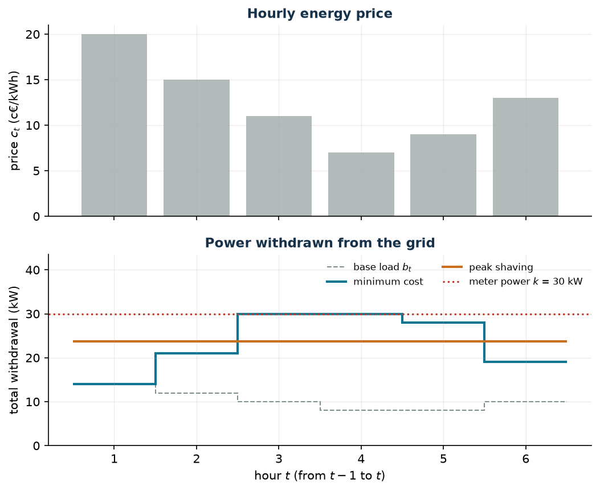
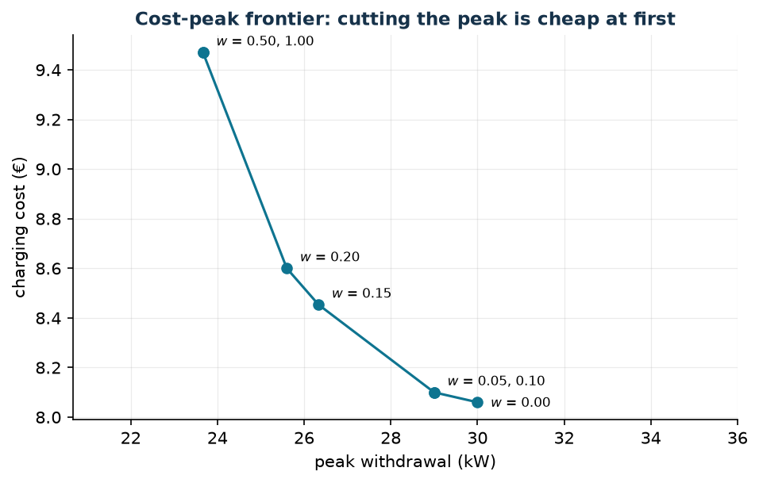

# Smart charging of electric vehicles

[:material-file-pdf-box: Lecture notes (PDF)](pdf/lp-modelling-notes.pdf) · [:material-presentation: Chapter slides (PDF)](pdf/slides-06-ev-charging.pdf) · [:material-gesture-tap: App: Minimum-cost overnight charging](lab/ev-charging.md)

**Class:** LP · **Script:** `python/lab06_ev_charging.py`

[](https://colab.research.google.com/github/fabiofurini/lp-modelling/blob/main/notebooks/lab06_ev_charging.ipynb)

!!! nota "Prerequisites"

    - From this module, [Chapter 2 «Background: linear programming and sensitivity analysis»](https://fabiofurini.github.io/lp-modelling/theory-lp/): shadow prices and the sensitivity protocol.

    - From this module, [Chapter 3 «The solver: building, solving, interpreting»](https://fabiofurini.github.io/lp-modelling/solver-lp/): variable bounds in `gurobipy` and the right-hand side stored by the solver.

!!! chiave "Objectives"

    At the end of this chapter you will be able to:

    - model decisions over an hourly horizon with availability windows;

    - read the duals as prices of the marginal hours;

    - handle the cost-peak trade-off with a weighted objective;

    - diagnose a real pitfall of sensitivity analysis: the right-hand side with constants.

A fleet must be fully charged by the morning by exploiting the cheap hours — but if
all the vehicles charge together, the peak draw explodes. A problem that *seems* to
require on/off variables and instead is a pure LP: the real decision — how much
power — is continuous.

**The problem in words.** *We decide* the power $x_{vt}$ for each vehicle and hour.
*The objective*: minimum energy expenditure. *The constraints*: the energy required
before departure, charging only while plugged in and below the power of the charger,
total draw below the power of the meter.

## Model

**Data (input of the model).**

| Symbol | Type | Meaning |
|---|---|---|
| $n$ | $\in \mathbb{Z}_{\ge 1}$ | number of vehicles, indexed by $v \in \{1, 2, \dots, n\}$ |
| $m$ | $\in \mathbb{Z}_{\ge 1}$ | number of hourly intervals, indexed by $t \in \{1, 2, \dots, m\}$, of duration $d$ (here $d = 1$ h) |
| $c_t$ | $\in \mathbb{Q}_{\ge 0}$ | energy price in hour $t$ (€/kWh) |
| $a_{vt}$ | $\in \{0, 1\}$ | observed *datum*: $1$ if vehicle $v$ is plugged in during hour $t$, $0$ otherwise |
| $e_v$ | $\in \mathbb{Q}_{> 0}$ | energy required by vehicle $v$ before departure (kWh) |
| $\bar p_v$ | $\in \mathbb{Q}_{> 0}$ | maximum charging power of vehicle $v$ (kW) |
| $b_t$ | $\in \mathbb{Q}_{\ge 0}$ | base load of the building in hour $t$ (kW) |
| $k$ | $\in \mathbb{Q}_{> 0}$ | maximum power that can be drawn from the meter (kW) |
| $r$ | $\in \mathbb{Q},\ 0 < r \le 1$ | charging efficiency |

**Decision variables.** We introduce the following $n\,m$ non-negative variables:

$$
x_{vt} = \text{power assigned to vehicle } v \text{ in hour } t \text{ (kW)},
\qquad \forall v \in \{1, 2, \dots, n\},~\forall t \in \{1, 2, \dots, m\}.
$$

Using these variables, an LP model for the problem is the following:

$$
\begin{aligned}
\min ~~ \sum_{v=1}^{n} \sum_{t=1}^{m} c_t\, d\, x_{vt} & & \\
\text{subject to} \quad r \sum_{t=1}^{m} d\, x_{vt} &\ge e_v, & \forall v \in \{1, 2, \dots, n\}, \\
\sum_{v=1}^{n} x_{vt} + b_t &\le k, & \forall t \in \{1, 2, \dots, m\}, \\
x_{vt} &\le a_{vt}\, \bar p_v, & \forall v \in \{1, 2, \dots, n\},~\forall t \in \{1, 2, \dots, m\}, \\
x_{vt} &\ge 0, & \forall v \in \{1, 2, \dots, n\},~\forall t \in \{1, 2, \dots, m\}.
\end{aligned}
$$

Description of the objective function and of the constraints:

- the linear objective function minimizes the energy expenditure of the night: the
  power $x_{vt}$ delivered for the duration $d$ costs
  $c_t\, d\, x_{vt}$ euros;
- the linear **energy** constraints ensure that every vehicle receives all the energy
  it requires before departure; the efficiency $r$ stands on the left: of the
  energy that is drawn, only the fraction $r$ ends up in the battery ($n$ linear
  constraints);
- the linear **grid** constraints impose that the overall draw (charging plus base
  load) never exceeds the power of the meter: these are the constraints that couple
  the vehicles to each other ($m$ linear constraints);
- the linear **power** constraints limit the power of every vehicle to that of its
  charger and set it to zero in the hours in which the vehicle is absent
  ($a_{vt} = 0$): availability is a *datum*, not a decision, and this is why no
  binary variables are needed ($n\,m$ linear constraints);
- the non-negativity constraints on $x_{vt}$ define the variables of the model.

Variants: peak shaving ($\min z$ with $\sum_{v=1}^{n} x_{vt} + b_t \le z$ for every
$t \in \{1, 2, \dots, m\}$); multi-objective cost $+\,w\,z$.
The energy constraint is written as $\ge$ because charging more than necessary is
allowed but never worthwhile (the price is positive): at the optimum it holds with
equality.

!!! example "Worked example by hand (1 vehicle, 2 hours)"
    $e = 10$ kWh ($r = 1$), prices $c_1 = 0{,}10$ and $c_2 = 0{,}20$ €/kWh,
    $\bar p = 8$ kW: we charge 8 kWh in the cheap hour and 2 in the expensive one
    (cost $8 \cdot 0{,}10 + 2 \cdot 0{,}20 = 1{,}20$ €). Shadow price of the energy
    requirement = 0.20 €/kWh (the price of the *marginal hour*); shadow price of the
    power limit in hour 1 = 0.10 €/kW. With $\bar p = 12$: everything in the cheap
    hour, cost 1.00 €, dual of the requirement 0.10 and dual of the power 0
    (constraint not active).

## Case study

Three vans ($n = 3$) in the six hours from midnight to 6 am ($m = 6$, $d = 1$ h, hour
$t$ runs from $t-1$ to $t$), meter $k = 30$ kW, efficiency $r = 0.9$ (data in
`data/ev_prezzi_base.csv` and `data/ev_flotta.csv`). There are 18 variables, but 6 of
them are 0 because the van is not plugged in ($a_{vt} = 0$): 12 variables remain, with
3 energy constraints and 6 grid constraints.

| hour $t$ | 1 | 2 | 3 | 4 | 5 | 6 |
|---|---|---|---|---|---|---|
| from–to | 0–1 | 1–2 | 2–3 | 3–4 | 4–5 | 5–6 |
| $c_t$ (€/kWh) | 0.20 | 0.15 | 0.11 | 0.07 | 0.09 | 0.13 |
| $b_t$ (kW) | 14 | 12 | 10 | 8 | 8 | 10 |

| Van $v$ | plugged in | hours with $a_{vt} = 1$ | $e_v$ (kWh) | $e_v/r$ (kWh drawn) | $\bar p_v$ (kW) |
|---|---|---|---|---|---|
| 1 | from 0:00 to 6:00 | 1–6 | 36 | 40 | 11 |
| 2 | from 0:00 to 3:00 | 1–3 | 18 | 20 | 11 |
| 3 | from 3:00 to 6:00 | 4–6 | 18 | 20 | 16 |

Without the meter limit every van would charge in its cheapest hours and the draw
would reach 35 kW in hour 4 (8 of base load, 11 of van 1, 16 of van 3): with
$k = 30$ kW part of the charging has to move.

```text
Minimum cost   : 8.06 EUR/night   peak draw 30.0 kW (limit 30)
Power x[v,t] (kW), hours t = 1..6:
  V1:   0.0   0.0   9.0  11.0  11.0   9.0
  V2:   0.0   9.0  11.0     .     .     .
  V3:     .     .     .  11.0   9.0   0.0
Shadow prices of the energy requirement (EUR/kWh):  V1 0.1444   V2 0.1667   V3 0.1000
Shadow prices of the grid (EUR/kW)               :  hours 3 and 4: 0.02   other hours: 0
Peak shaving   : minimum possible peak 23.7 kW
```



Hours 3 and 4 are binding: the draw reaches the 30 kW of the meter. The shadow prices
of the energy requirement are $0.1444 = 0.13/r$, $0.1667 = 0.15/r$ and
$0.1000 = 0.09/r$: they are the prices of the **marginal hours** of each van (the
most expensive hour it uses below the power of its charger), corrected for the
efficiency. Van 1 completes its charge in hour 6, van 2 in hour 2, van 3 in hour 5.

The shadow prices of the grid are price differences between two hours as well. One
more kW in hour 3 lets van 1 move one kWh from hour 6 to hour 3
($0.13 - 0.11 = 0.02$ €); one more kW in hour 4 lets van 3 move it from hour 5 to
hour 4 ($0.09 - 0.07 = 0.02$ €).

## Sensitivity



```text
Trade-off cost + w*peak:
  w = 0.00: cost 8.06  peak 30.0     w = 0.15: cost 8.45  peak 26.3
  w = 0.05: cost 8.10  peak 29.0     w = 0.20: cost 8.60  peak 25.6
  w = 0.10: cost 8.10  peak 29.0     w = 0.50: cost 9.47  peak 23.7
Meter capacity:
  k = 23 kW: INFEASIBLE     k = 28: 8.22     k = 32: 7.98
  k = 24 kW: 9.32           k = 30: 8.06     k = 35: 7.92
  k = 26 kW: 8.52
```

Cutting the peak from 30 to 29 kW costs 4 cents per night; going down to 25.6 kW
(−15%) costs 54. The minimum peak, 23.7 kW, costs 9.47 € (+1.41 €): the draw is flat,
that is the 142 kWh of the night (62 of base load and 80 for the vans) divided by the
6 hours. The cost depends only on the draw in each hour, so every plan with the
minimum peak costs 9.47 €.

The meter behaves the same way: from 35 to 30 kW the expenditure grows by 14 cents,
from 30 to 24 kW by 1.26 €. Below 23.7 kW the problem is infeasible, because not even
the flat draw fits under the limit.

!!! warning "An instructive bug (which really happened)"
    In the constraint `quicksum(x) + base[t] <= C` Gurobi moves the constant into the
    right-hand side: the stored RHS is `C - base[t]`. Whoever writes `v.RHS = newC`
    is relaxing the wrong constraint. When a sensitivity analysis changes nothing,
    suspect your own code before suspecting the model.


A *smooth* load profile, which penalizes the changes of the load from one hour to
the next, requires a quadratic term in the objective and is no longer an LP: it is
the quadratic variant of this model, in the module *NLP Modelling*, page
[“Electric vehicle charging with a smooth profile”](https://fabiofurini.github.io/nlp-modelling/ev-charging-quadratic/).

## In summary

!!! chiave "In summary"

    - Smart charging is a pure LP: the decision is how much power, and availability is a datum, not a binary variable.

    - The cheap hours are filled first; the shadow price of the energy requirement is the price of the marginal hour, divided by $r$.

    - Cost $+\,w\,$peak traces the cost-peak frontier: the peak drops a lot for a small increase in cost.

    - The constants of the constraints end up in the right-hand side: if a sensitivity analysis changes nothing, check the code first.

## Code

The complete script of the chapter — data, model, solution, sensitivity and figures —
is [`python/lab06_ev_charging.py`](https://github.com/fabiofurini/lp-modelling/blob/main/python/lab06_ev_charging.py)
(reproducible with `python3 python/lab06_ev_charging.py` from the `python/` folder).

The same code is also available as a notebook — [`notebooks/lab06_ev_charging.ipynb`](https://github.com/fabiofurini/lp-modelling/blob/main/notebooks/lab06_ev_charging.ipynb) — which opens in Colab from the badge at the top of the page and runs in the browser, with nothing to install.

??? example "Show the full script — `lab06_ev_charging.py`"

    ```python
    """Chapter 6 — Smart charging of electric vehicles (LP).

    Case study: a company depot with 3 electric vans to be charged in the 6 hours
    from midnight to 6 am; hourly energy prices; base load of the building.

    Contents:
      1. Minimum-cost LP: charging chases the cheap hours
      2. Peak shaving: minimise the peak withdrawal (minimax)
      3. Multi-objective cost-peak comparison
      4. Shadow prices: grid capacity and energy requirement
    """
    import gurobipy as gp
    import pandas as pd
    from gurobipy import GRB

    from stile import (ARANCIO, GRIGIO, ROSSO, TEAL, intestazione, plt, salva_dat, salva_dati,
                       salva_figura)

    # ----------------------------------------------------------------------
    # 1. DATA
    # ----------------------------------------------------------------------
    ore = list(range(1, 7))                    # hour t = from t-1 to t (t = 1: from 0:00 to 1:00)
    # price €/kWh: high in the first hours (tail of the evening peak), lowest from 3 to 4 am
    prezzo = pd.Series([0.20, 0.15, 0.11, 0.07, 0.09, 0.13], index=ore)
    # base load of the building (kW)
    base = pd.Series([14.0, 12.0, 10.0, 8.0, 8.0, 10.0], index=ore)

    veicoli = ["V1", "V2", "V3"]
    # (arrival hour, departure hour, required energy kWh, max power kW)
    flotta = {
        "V1": (0, 6, 36, 11),     # plugged in all night
        "V2": (0, 3, 18, 11),     # leaves at 3 am for the first shift
        "V3": (3, 6, 18, 16),     # back at 3 am from the last shift
    }
    eta = 0.9             # charging efficiency
    C_rete = 30.0         # maximum power that can be drawn from the meter (kW)

    # plugged in during hour t (from t-1 to t) if it arrived by t-1 and leaves at t or later
    disp = {(v, t): 1 if flotta[v][0] < t <= flotta[v][1] else 0
            for v in veicoli for t in ore}

    salva_dati(pd.DataFrame({"hour": ore, "price": prezzo, "base_load": base}), "ev_prezzi_base")
    salva_dati(pd.DataFrame([(v, *flotta[v]) for v in veicoli],
                            columns=["vehicle", "arrival", "departure", "energy_kWh", "pmax_kW"]),
               "ev_flotta")


    def costruisci():
        m = gp.Model("ev_charging")
        m.Params.OutputFlag = 0
        x = m.addVars(veicoli, ore, name="x")       # charging power (kW)
        for v in veicoli:
            for t in ore:
                x[v, t].UB = flotta[v][3] * disp[v, t]     # 0 if not plugged in
        v_ene = m.addConstrs((eta * gp.quicksum(x[v, t] for t in ore) >= flotta[v][2]
                              for v in veicoli), name="energy")
        v_rete = m.addConstrs((gp.quicksum(x[v, t] for v in veicoli) + base[t] <= C_rete
                               for t in ore), name="grid")
        return m, x, v_ene, v_rete


    def profilo(x):
        return pd.Series([sum(x[v, t].X for v in veicoli) for t in ore], index=ore)


    # ----------------------------------------------------------------------
    # 2. MINIMUM-COST LP
    # ----------------------------------------------------------------------
    intestazione("LP: minimum energy cost")
    m, x, v_ene, v_rete = costruisci()
    m.setObjective(gp.quicksum(prezzo[t] * x[v, t] for v in veicoli for t in ore), GRB.MINIMIZE)
    m.optimize()
    assert m.Status == GRB.OPTIMAL
    prof_costo = profilo(x)
    costo_min = m.ObjVal
    picco_costo = (prof_costo + base).max()
    print(f"Charging cost: {costo_min:.2f} €   peak withdrawal: {picco_costo:.1f} kW "
          f"(limit {C_rete:.0f})")
    print("\nPower x[v, t] (kW), hours t = 1..6:")
    for v in veicoli:
        print(f"  {v}: " + "  ".join(f"{x[v, t].X:5.1f}" if disp[v, t] else "    ." for t in ore))
    print("\nShadow prices of the energy requirement (marginal cost of 1 more kWh per vehicle):")
    for v in veicoli:
        print(f"  {v}: {v_ene[v].Pi:.4f} €/kWh")
    print("Shadow prices of the grid (saving for 1 more kW in hour t):")
    print("  " + "  ".join(f"t={t}: {abs(v_rete[t].Pi):.3f}" for t in ore))

    # ----------------------------------------------------------------------
    # 3. PEAK SHAVING (minimax) and COST-PEAK TRADE-OFF
    # ----------------------------------------------------------------------
    intestazione("Peak shaving: minimise the peak withdrawal")
    mp, xp, _, _ = costruisci()
    z = mp.addVar(name="peak")
    mp.addConstrs((gp.quicksum(xp[v, t] for v in veicoli) + base[t] <= z for t in ore),
                  name="peak_def")
    mp.setObjective(z, GRB.MINIMIZE)
    mp.optimize()
    prof_picco = profilo(xp)
    costo_picco = sum(prezzo[t] * prof_picco[t] for t in ore)
    print(f"Lowest achievable peak: {mp.ObjVal:.1f} kW   cost: {costo_picco:.2f} € "
          f"(+{costo_picco - costo_min:.2f} € with respect to the minimum cost)")

    intestazione("Trade-off: cost + w · peak")
    compromessi = []
    for rho in [0, 0.05, 0.1, 0.15, 0.2, 0.5, 1.0]:
        mc, xc, _, _ = costruisci()
        zc = mc.addVar(name="peak")
        mc.addConstrs((gp.quicksum(xc[v, t] for v in veicoli) + base[t] <= zc for t in ore))
        mc.setObjective(gp.quicksum(prezzo[t] * xc[v, t] for v in veicoli for t in ore)
                        + rho * zc, GRB.MINIMIZE)
        mc.optimize()
        cc = sum(prezzo[t] * xc[v, t].X for v in veicoli for t in ore)
        compromessi.append((rho, cc, zc.X))
        print(f"  w = {rho:4.2f}: cost {cc:6.2f} €, peak {zc.X:6.1f} kW")
    salva_dati(pd.DataFrame(compromessi, columns=["rho", "cost", "peak"]), "ev_compromessi")

    # ----------------------------------------------------------------------
    # 4. SENSITIVITY: capacity of the meter
    # ----------------------------------------------------------------------
    intestazione("Sensitivity: capacity of the grid connection")
    # careful: in the constraint "sum x + base[t] <= C" Gurobi moves the constant base[t]
    # into the right-hand side; the stored RHS is C - base[t], so it must be updated like this:
    for CC in [23, 24, 26, 28, 30, 32, 35]:
        ms, xs_, _, vr = costruisci()
        for t in ore:
            vr[t].RHS = CC - base[t]
        ms.setObjective(gp.quicksum(prezzo[t] * xs_[v, t] for v in veicoli for t in ore),
                        GRB.MINIMIZE)
        ms.optimize()
        esito = f"cost {ms.ObjVal:6.2f} €" if ms.Status == GRB.OPTIMAL else "INFEASIBLE"
        print(f"  C_grid = {CC:3d} kW: {esito}")

    # ----------------------------------------------------------------------
    # 5. FIGURES (pgfplots data + matplotlib preview)
    # ----------------------------------------------------------------------
    salva_dat(pd.DataFrame({"hour": ore, "price_cent": prezzo * 100, "base": base,
                            "totcost": base + prof_costo, "totpeak": base + prof_picco}),
              "cap06_profili")
    salva_dat(pd.DataFrame(compromessi, columns=["rho", "cost", "peak"]), "cap06_frontiera")
    # one-hour-wide steps for pgfplots (const plot): edges 0.5, 1.5, ..., 6.5, the last value repeated
    bordi = [t - 0.5 for t in ore] + [ore[-1] + 0.5]


    def gradino(serie):
        return list(serie) + [serie.iloc[-1]]


    salva_dat(pd.DataFrame({"x": bordi, "base": gradino(base), "totcost": gradino(base + prof_costo),
                            "totpeak": gradino(base + prof_picco)}), "cap06_gradini")

    fig, (ax1, ax2) = plt.subplots(2, 1, figsize=(8.2, 6.4), sharex=True)
    ax1.bar(ore, prezzo * 100, color=GRIGIO, alpha=0.6)
    ax1.set_ylabel("price $c_t$ (c€/kWh)")
    ax1.set_title("Hourly energy price")
    # same entries, colours and title as the lab app; legend above the meter limit
    # one column per hour: steps one hour wide, from t-1 to t (edges as above)
    ax2.stairs(base, bordi, baseline=None, color=GRIGIO, ls="--", label="base load $b_t$")
    ax2.stairs(base + prof_costo, bordi, baseline=None, color=TEAL, lw=2, label="minimum cost")
    ax2.stairs(base + prof_picco, bordi, baseline=None, color=ARANCIO, lw=2, label="peak shaving")
    ax2.axhline(C_rete, color=ROSSO, ls=":", label=f"meter power $k$ = {C_rete:.0f} kW")
    ax2.set_ylim(0, C_rete * 1.45)
    ax2.set_xticks(ore); ax2.set_xlabel("hour $t$ (from $t-1$ to $t$)"); ax2.set_ylabel("total withdrawal (kW)")
    ax2.set_title("Power withdrawn from the grid")
    ax2.legend(fontsize=8, ncol=2, loc="upper right")
    salva_figura(fig, "cap06_profili")

    comp = pd.DataFrame(compromessi, columns=["rho", "cost", "peak"])
    fig, ax = plt.subplots()
    ax.plot(comp["peak"], comp["cost"], "-o", color=TEAL)
    # weights with the same point (same peak and cost) in a single label
    groups = comp.groupby([comp["peak"].round(3), comp["cost"].round(4)], sort=False)
    for k, ((pk, cc), g) in enumerate(groups):
        weights = ", ".join(f"{w:.2f}" for w in g["rho"])
        ax.annotate(f"$w$ = {weights}", (pk, cc), textcoords="offset points", xytext=(8, -3 if k == 0 else 4),
                    fontsize=8)
    ax.set_xlim(comp["peak"].min() - 3, comp["peak"].max() + 6)
    ax.set_xlabel("peak withdrawal (kW)")
    ax.set_ylabel("charging cost (€)")
    ax.set_title("Cost-peak frontier: cutting the peak is cheap at first")
    salva_figura(fig, "cap06_frontiera")

    print("\nDone: chapter 6.")
    ```

## Exercises

1. $e_1: 36 \to 37$ kWh: cost from 8.06 to 8.2044 €, $+0.1444 = 0.13/0.9$ (verified).
2. Van 3 comes back at 4 am instead of 3 am: how do the cost, the binding hours and the shadow prices change?
3. Cost-emissions frontier with an hourly carbon intensity $g_t$.
4. Minimum feasible capacity by bisection: $\tilde k = 142/6 \approx 23.67$ kW.

<!-- laboratorio-interattivo: sezione generata da genera_laboratorio.py -->

## Interactive lab { #interactive-lab }

The app of this chapter solves the model in the browser, with the data of the case study. ▶ next to a slider makes it move by itself.
It also opens full page in the [interactive lab](lab/index.md): [Minimum-cost overnight charging](lab/ev-charging.md).

<div class="gi gi-capitolo" data-grafico="pl-ricarica-ev"></div>
