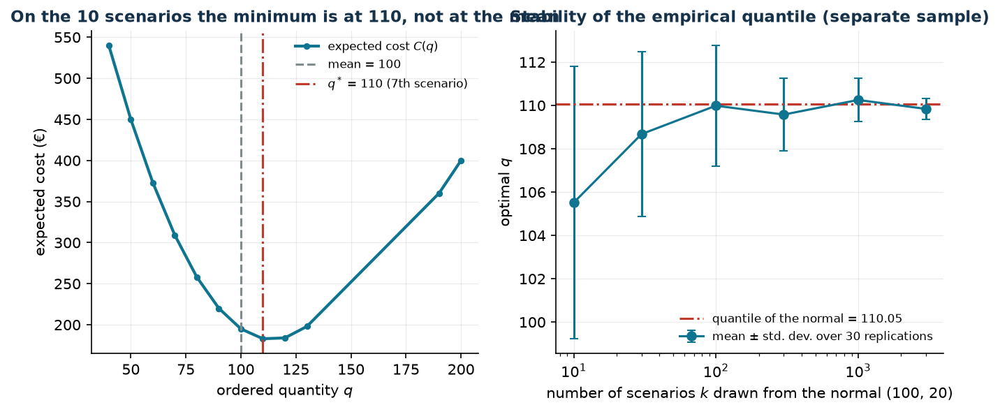
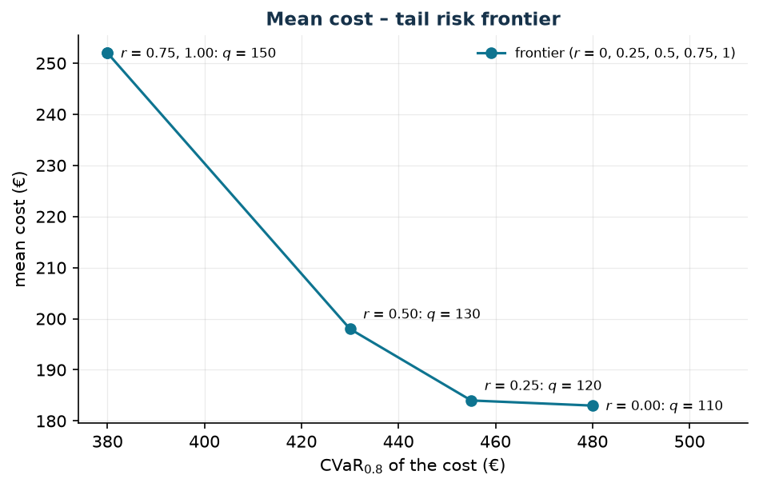

# The Newsvendor and its variants

[:material-file-pdf-box: Lecture notes (PDF)](pdf/lp-modelling-notes.pdf) · [:material-presentation: Chapter slides (PDF)](pdf/slides-08-newsvendor.pdf) · [:material-gesture-tap: App: Newsvendor: optimal order over 10 scenarios](lab/newsvendor-scenarios.md)

**Class:** 1D convex / scenario-based stochastic LP · **Script:** `python/lab08_newsvendor.py`

[](https://colab.research.google.com/github/fabiofurini/lp-modelling/blob/main/notebooks/lab08_newsvendor.ipynb)

!!! nota "Prerequisites"

    - From this module, [Chapter 2 «Background: linear programming and sensitivity analysis»](https://fabiofurini.github.io/lp-modelling/theory-lp/): shadow prices and their validity ranges.

    - From this module, [Chapter 3 «The solver: building, solving, interpreting»](https://fabiofurini.github.io/lp-modelling/solver-lp/): building and solving an LP in `gurobipy`.

!!! chiave "Objectives"

    At the end of this chapter you will be able to:

    - derive and apply the quantile rule;

    - turn a stochastic problem into a scenario-based LP with the positive-part trick;

    - quantify the value of modelling uncertainty (VSS);

    - incorporate service levels and risk aversion.

Choosing a quantity **before** observing demand: fashion and seasonal goods, fresh
products, drugs, hotel capacity. It is the gateway to stochastic optimization, with
a clear-cut result: **the optimal quantity is not the average demand**.

**The problem in words.** *We decide* the single quantity $q$. *The objective*: the
minimum expected cost of the error — too much ($c_o$ per unsold unit) or too little
($c_u$ per lost sale).

## Basic model and the quantile rule

**Data (input of the model).**

| Symbol | Type | Meaning |
|---|---|---|
| $D$ | random variable $\ge 0$ | demand, with cumulative distribution function $F$; an exception to the convention on capital letters, to follow the literature: the random variable in upper case, its realizations in lower case ($d_s$) |
| $c_u$ | $\in \mathbb{Q}_{> 0}$ | unit *underage* cost (unmet demand): lost margin plus any penalty (€) |
| $c_o$ | $\in \mathbb{Q}_{> 0}$ | unit *overage* cost (unsold unit): cost minus salvage value (€) |

With selling price $p$, purchase cost $c$ and salvage value $v \le c$ (all in
$\mathbb{Q}_{>0}$): $c_u = p - c$ and $c_o = c - v$.

**Decision variable.** We introduce a non-negative variable:

$$
q = \text{quantity ordered before observing demand } D.
$$

Using this variable, the model for the problem is the following:

$$
\begin{aligned}
\min ~~ c_o\, \mathbb{E}\bigl[(q - D)^+\bigr] + c_u\, \mathbb{E}\bigl[(D - q)^+\bigr] & & \\
\text{subject to} \quad q &\ge 0. &
\end{aligned}
$$

Description of the objective function and of the constraint:

- the convex objective function minimizes the expected cost of the error: overage
  $(q - D)^+$ charged at $c_o$ and underage $(D - q)^+$ charged at $c_u$ (the symbol
  $(x)^+ = \max\{x, 0\}$ denotes the positive part);
- the non-negativity constraint defines the variable of the model.

If $F$ is continuous, the optimum satisfies the **quantile rule**:

$$
F(\tilde q) = f = \frac{c_u}{c_u + c_o}
\qquad\Longrightarrow\qquad
\tilde q = F^{-1}(f).
$$

Marginal reasoning: the $q$-th extra unit yields $c_u$ if demand absorbs it
(probability $1 - F(q)$) and costs $c_o$ if it remains unsold (probability $F(q)$);
it is worth ordering as long as $c_u\,(1 - F(q)) \ge c_o\,F(q)$, that is, as long as
$F(q) \le c_u/(c_u + c_o)$.

!!! example "Worked example by hand (discrete demand)"
    $D \in \{80, 100, 120\}$ equally likely, $c_u = 9$, $c_o = 4$ (hence
    $f = 9/13 = 0{,}6923$): $C(80) = 180$, $C(100) = 86{,}7$,
    $C(120) = \mathbf{80}$. We order the **maximum**: with $c_u \gg c_o$ running short
    costs more than twice as much as running long. (Discrete rule: the smallest $q$
    with $F(q) \ge 0{,}6923$, that is, $\tilde q = 120$.)

## Case study

Bakery: $p = 15$, $c = 6$, $v = 2$ € → $c_u = 9$, $c_o = 4$, hence
$f^* = 9/13 = 0.6923$. The demand for panettoni is described by $k = 10$ equally
likely scenarios ($w_s = 1/10$): nine regular seasons, from 50 to 130 pieces, and an
exceptional season of 190 pieces, the right tail (data in
`data/newsvendor_scenari.csv`). The mean demand is 100.

| scenario $s$ | 1 | 2 | 3 | 4 | 5 | 6 | 7 | 8 | 9 | 10 |
|---|---|---|---|---|---|---|---|---|---|---|
| $d_s$ | 50 | 60 | 70 | 80 | 90 | 100 | 110 | 120 | 130 | 190 |
| $F(d_s)$ | 0.1 | 0.2 | 0.3 | 0.4 | 0.5 | 0.6 | 0.7 | 0.8 | 0.9 | 1 |
| $C(d_s)$ (€) | 450 | 373 | 309 | 258 | 220 | 195 | **183** | 184 | 198 | 360 |

The discrete quantile rule takes the smallest $d_s$ with $F(d_s) \ge 0.6923$:
$F(100) = 0.6$ is not enough, $F(110) = 0.7$ is. Hence $\tilde q = 110$, the 7th
scenario in increasing order. The row of costs confirms it: $C(q)$ is piecewise
linear, with its vertices at the scenarios, and the minimum is at 110.

```text
f* = 9/13 = 0.6923
q* = the smallest d_s with F(d_s) >= 0.6923: 110 units   (mean = 100)
expected cost at q*: 183.00 EUR    at q = mean: 195.00 EUR
```



The plot on the left is the expected cost over the 10 scenarios. The one on the
right is a separate illustration, with its own sample, described below.

## The scenario-based linear formulation

When $F$ is not known in closed form — the normal situation in a company — one uses
scenarios. New model data: the number of scenarios $k \in \mathbb{Z}_{\ge 1}$,
indexed by $s \in \{1, 2, \dots, k\}$; for each scenario, the demand
$d_s \in \mathbb{Q}_{\ge 0}$ and the probability $w_s \in \mathbb{Q}_{\ge 0}$, with
$\sum_{s=1}^{k} w_s = 1$. Besides $q$, we introduce the following $2\,k$
non-negative variables:

$$
\begin{cases}
o_s = \text{overage (unsold units) in scenario } s\\[1ex]
u_s = \text{underage (unmet demand) in scenario } s
\end{cases}
\qquad \forall s \in \{1, 2, \dots, k\}.
$$

Using these variables, an LP model for the problem is the following:

$$
\begin{aligned}
\min ~~ \sum_{s=1}^{k} w_s \bigl( c_o\, o_s + c_u\, u_s \bigr) & & \\
\text{subject to} \quad o_s &\ge q - d_s, & \forall s \in \{1, 2, \dots, k\}, \\
u_s &\ge d_s - q, & \forall s \in \{1, 2, \dots, k\}, \\
q &\ge 0, & \\
o_s,\ u_s &\ge 0, & \forall s \in \{1, 2, \dots, k\}.
\end{aligned}
$$

Description of the objective function and of the constraints:

- the linear objective function is the weighted average, over the scenarios, of the
  overage and underage costs: the "scenario-based" version of the expected cost of
  the basic model;
- the linear **overage** and **underage** constraints define $o_s$ and $u_s$ starting
  from the only genuine decision $q$; together with the non-negativity conditions
  they realize the positive parts ($2\,k$ linear constraints);
- the constraints on $q$, $o_s$ and $u_s$ define the variables of the model.

The **positive-part trick**: the objective pushes $o_s$ and $u_s$ down onto the
values $\max\{q - d_s, 0\}$ and $\max\{d_s - q, 0\}$ without binary variables — the
same mechanism returns in the CVaR and in quantile regression.

With the 10 scenarios of the case the LP has 21 variables ($q$, 10 overages and 10
underages) and 20 constraints, two per scenario: for scenario 1, $q - o_1 \le 50$
and $q + u_1 \ge 50$. In the objective function each $o_s$ has coefficient
$c_o/10 = 0.4$ and each $u_s$ has $c_u/10 = 0.9$:

$$
\begin{array}{rrcrcrcl}
\min & & & 0.4 \textstyle\sum_{s=1}^{10} o_s & + & 0.9 \textstyle\sum_{s=1}^{10} u_s & & \\[1ex]
\text{subject to} & q & - & o_s & & & \le & d_s, \\
 & q & & & + & u_s & \ge & d_s, \qquad s = 1, \dots, 10, \\[1ex]
 & q, & & o_s, & & u_s & \ge & 0,
\end{array}
$$

with $d_1, \dots, d_{10} = 50, 60, 70, 80, 90, 100, 110, 120, 130, 190$. The numerical
model written row by row, scenario by scenario, is in the app at the bottom of the page.

```text
LP with k = 10 scenarios (21 variables, 20 constraints): q = 110
empirical quantile at 69.23%: 110   (they coincide: it is a theorem)
  s     1   2   3   4   5   6   7   8   9  10
d_s    50  60  70  80  90 100 110 120 130 190
o_s    60  50  40  30  20  10   0   0   0   0
u_s     0   0   0   0   0   0   0  10  20  80
cost  240 200 160 120  80  40   0  90 180 720    mean 183
VSS: decision q = E[D] = 100 costs 195; stochastic q costs 183
     value of the stochastic solution = 12 EUR per cycle
```

The *value of the stochastic solution* (VSS) is worth 12 € per cycle here, 6.6% of
the cost: it is the gain from **modelling** uncertainty instead of replacing it with
the mean. The exceptional scenario alone, with 80 pieces of unmet demand, weighs
72 € of the 183 of the expected cost.

**Stability of the empirical quantile.** Ten scenarios are few, and scenarios are a
sample too. The plot on the right shows it with a separate illustration: it does not
use the 10 scenarios of the case, but samples of $k$ scenarios drawn from a normal
demand with mean 100 and standard deviation 20, 30 samples for each $k$.

```text
theoretical quantile of the normal: F^-1(0.6923) = 110.05
k =   10: mean q 105.52, std. dev. over 30 replications 6.28
k =  100: mean q 109.99, std. dev. over 30 replications 2.78
k = 3000: mean q 109.84, std. dev. over 30 replications 0.47
```

With 10 scenarios the optimal $q$ changes by about ±6 units from one sample to
another, with 100 by about ±3, with 3000 by half a unit: the decision inherits the
variance of the scenarios.

## Service levels and risk

```text
    q   P(D<=q)   fill rate   cost
  100     60%        85%      195
  110     70%        89%      183   <- economic optimum
  120     80%        92%      184
  130     90%        94%      198   <- cycle service level 90%  (+15 EUR)
  140     90%        95%      225   <- fill rate 95%            (+42 EUR)
  190    100%       100%      360   <- cycle service level 95%  (+177 EUR)
```

!!! warning "Do not confuse the service levels"
    At $\tilde q = 110$ the probability of avoiding a stock-out is 70%, but the
    *fill rate* (share of demand served on average) is 89%: different measures that
    contracts often confuse. Promising "95% probability of full coverage" forces one
    to cover the exceptional scenario and costs +177 € per cycle; promising "95% fill
    rate" costs +42 €. Read the SLA carefully before signing it.

With the linear formulation of the CVaR we minimize
$(1-r)\,\mathbb{E}[\text{cost}] + r\, \mathrm{CVaR}_{0.8}(\text{cost})$. The level is
$\alpha = 0.8$: with 10 equally likely scenarios the tail $1 - \alpha = 0.2$ is
exactly the 2 most expensive scenarios, and the CVaR is the mean of their costs.
With $\alpha = 0.9$ the tail would be the worst scenario alone.

```text
r = 0.00: q = 110  mean cost 183  CVaR80 480
r = 0.25: q = 120  mean cost 184  CVaR80 455
r = 0.50: q = 130  mean cost 198  CVaR80 430
r = 0.75: q = 150  mean cost 252  CVaR80 380
r = 1.00: q = 150  mean cost 252  CVaR80 380
thresholds: q moves to 120 for r > 1/26 = 0.038, to 130 for r > 14/39 = 0.359,
            to 150 for r > 54/104 = 0.519
```



At $q = 110$ the two most expensive scenarios are the exceptional one (720 €, 80 lost
sales) and the one of 50 pieces (240 €, 60 unsold): CVaR $= (720 + 240)/2 = 480$ €.
The risk-averse decision maker orders more. The first step, from 110 to 120, costs
1 € on average and cuts the CVaR by 25 €. The last one, from 130 to 150, costs 54 €
for 50 € of CVaR: the first steps give a lot of protection for little mean cost,
the last one little protection for a lot of cost.

With $r = 1$ the order stops at 150: there the scenario of 60 pieces (90 unsold,
360 €) costs as much as the exceptional scenario (40 lost sales, 360 €). Ordering even
more would raise the cost of the unsold units in the tail.

## Multi-product with a shared budget

Three cakes on the same 10 scenarios, with a production budget of 1250 €. The demands
are linked: good and bad seasons are good and bad for all three.

| cake | $c$ (€) | $c_u$ | $c_o$ | demands $d_s$ in scenarios 1–10 |
|---|---|---|---|---|
| panettone | 6 | 9 | 4 | 50 60 70 80 90 100 110 120 130 190 |
| pandoro | 5 | 7 | 3.5 | 40 40 50 60 70 80 90 90 100 150 |
| torrone | 4 | 5 | 2.5 | 30 40 40 50 50 60 70 70 80 110 |

```text
  product   | q without budget | q with budget
 panettone  |            110.0 |        101.67
 pandoro    |             90.0 |         80.00
 torrone    |             70.0 |         60.00
Spend without budget 1390 EUR; with the budget 1250/1250
expected cost 386.50 EUR   shadow price of the budget: -0.200
```

The binding budget compresses the three quantities below their respective optimal
quantiles, but not proportionally: pandoro loses 11%, torrone 14%, panettone 8%. The
dual says that one more euro of budget would reduce the expected cost by 0.20 €. The
computation can be done by hand: the euro goes to panettone, whose $q$ lies between
100 and 110 ($F = 0.6$); there one more piece saves $9 \cdot 0.4 - 4 \cdot 0.6 = 1.2$ €
and costs 6 €, that is, $1.2/6 = 0.20$ € per euro.

The expected cost of each cake depends only on its own demands: linked or not, the
optimal quantities do not change. The link matters for risk: in the bad seasons the
three cakes lose together.


## In summary

!!! chiave "In summary"

    - The quantity is chosen before observing demand, and the optimum is the quantile $q^* = F^{-1}\bigl(c_u/(c_u+c_o)\bigr)$, not the mean.

    - With $k$ scenarios the newsvendor becomes an LP with $2k+1$ variables: the positive parts are linearized without binary variables.

    - The VSS measures the gain from modelling uncertainty; decisions estimated from few scenarios are unstable.

    - Cycle service level and fill rate are different measures; with mean-CVaR a little risk aversion gives a lot of protection.

## Code

The complete script of the chapter — data, model, solution, sensitivity and figures —
is [`python/lab08_newsvendor.py`](https://github.com/fabiofurini/lp-modelling/blob/main/python/lab08_newsvendor.py)
(reproducible with `python3 python/lab08_newsvendor.py` from the `python/` folder).

The same code is also available as a notebook — [`notebooks/lab08_newsvendor.ipynb`](https://github.com/fabiofurini/lp-modelling/blob/main/notebooks/lab08_newsvendor.ipynb) — which opens in Colab from the badge at the top of the page and runs in the browser, with nothing to install.

??? example "Show the full script — `lab08_newsvendor.py`"

    ```python
    """Chapter 8 — The Newsvendor and its variants (scenario-based stochastic LP).

    Case study: a bakery deciding how many artisan panettoni to produce.
    Price p = 15 €, cost c = 6 €, salvage v = 2 € -> Cu = 9, Co = 4.
    Demand: 10 equally likely scenarios, nine regular ones from 50 to 130 and an exceptional one of 190.

    Contents:
      1. Quantile rule on the scenarios: f* = 9/13 = 0.6923 -> q* = 110 (7th scenario)
      2. Scenario LP: it coincides with the empirical quantile
      3. Value of the stochastic solution (VSS); stability of the empirical quantile
         (a separate illustration, with larger samples from a normal distribution)
      4. Service levels (cycle service level, fill rate)
      5. Risk aversion: mean cost - CVaR_0.8 frontier (the 2 worst scenarios)
      6. Multi-product with a shared budget
    """
    import gurobipy as gp
    import numpy as np
    import pandas as pd
    from gurobipy import GRB
    from scipy import stats

    from stile import (ARANCIO, GRIGIO, ROSSO, TEAL, intestazione, plt, salva_dat,
                       salva_dati, salva_figura)

    p, c, v = 15.0, 6.0, 2.0
    Cu, Co = p - c, c - v                 # 9 and 4

    # ----------------------------------------------------------------------
    # 1. DATA AND QUANTILE RULE ON THE SCENARIOS
    # ----------------------------------------------------------------------
    intestazione("Quantile rule on the 10 scenarios")
    # nine regular seasons (from 50 to 130) and an exceptional one (190): the right tail
    dom = np.array([50, 60, 70, 80, 90, 100, 110, 120, 130, 190], dtype=float)
    S = len(dom)                          # equally likely scenarios, w_s = 1/S
    salva_dati(pd.DataFrame({"scenario": range(1, S + 1), "demand": dom}), "newsvendor_scenari")


    def costo_atteso(q, d=dom):
        """Expected cost over the equally likely scenarios: mean of Co(q-d)^+ + Cu(d-q)^+."""
        return float(np.mean(Co * np.maximum(q - d, 0) + Cu * np.maximum(d - q, 0)))


    def quantile_empirico(d, f):
        """The smallest value d_s with F(d_s) >= f (discrete quantile rule)."""
        ordinati = np.sort(d)
        return ordinati[int(np.ceil(f * len(d) - 1e-9)) - 1]


    f_star = Cu / (Cu + Co)
    q_star = quantile_empirico(dom, f_star)
    print(f"Critical fractile f* = Cu/(Cu+Co) = {Cu:.0f}/{Cu + Co:.0f} = {f_star:.4f}")
    print(f"{'d_s':>5} {'F(d_s)':>7} {'C(d_s)':>8}")
    for k, d in enumerate(np.sort(dom), start=1):
        print(f"{d:5.0f} {k / S:7.1f} {costo_atteso(d):8.1f}" + ("   <- q*" if d == q_star else ""))
    print(f"q* = the smallest d_s with F(d_s) >= {f_star:.4f}: {q_star:.0f} units "
          f"(mean = {dom.mean():.0f}, cost at q = mean: {costo_atteso(dom.mean()):.1f} €)")

    # the expected cost is piecewise linear with its vertices at the scenarios: the vertices suffice
    qq = np.concatenate([[40.0], np.sort(dom), [200.0]])
    salva_dat(pd.DataFrame({"q": qq, "cost": [costo_atteso(q) for q in qq]}), "cap08_costo")

    # ----------------------------------------------------------------------
    # 2. SCENARIO LP
    # ----------------------------------------------------------------------
    intestazione(f"Scenario LP (k = {S}: {1 + 2 * S} variables, {2 * S} constraints)")


    def newsvendor_lp(dom_s, prob=None, lam=0.0, alpha_cvar=0.80):
        """LP: min (1-lam)·expected cost + lam·CVaR_alpha(cost). lam=0 -> risk neutral."""
        Sn = len(dom_s)
        pi = np.full(Sn, 1 / Sn) if prob is None else prob
        m = gp.Model("newsvendor")
        m.Params.OutputFlag = 0
        q = m.addVar(name="q")
        o = m.addVars(Sn, name="o")                 # overage
        u = m.addVars(Sn, name="u")                 # underage
        m.addConstrs((o[s] >= q - dom_s[s] for s in range(Sn)), name="over")
        m.addConstrs((u[s] >= dom_s[s] - q for s in range(Sn)), name="under")
        costo_s = {s: Co * o[s] + Cu * u[s] for s in range(Sn)}
        atteso = gp.quicksum(pi[s] * costo_s[s] for s in range(Sn))
        if lam > 0:
            eta = m.addVar(lb=-GRB.INFINITY, name="eta")
            xi = m.addVars(Sn, name="xi")
            m.addConstrs((xi[s] >= costo_s[s] - eta for s in range(Sn)), name="cvar")
            cvar = eta + gp.quicksum(pi[s] * xi[s] for s in range(Sn)) / (1 - alpha_cvar)
            m.setObjective((1 - lam) * atteso + lam * cvar, GRB.MINIMIZE)
        else:
            m.setObjective(atteso, GRB.MINIMIZE)
        m.optimize()
        assert m.Status == GRB.OPTIMAL
        costi = np.array([Co * max(q.X - d, 0) + Cu * max(d - q.X, 0) for d in dom_s])
        return q.X, float(costi @ pi), costi


    q_lp, costo_lp, costi_s = newsvendor_lp(dom)
    print(f"optimal q of the LP: {q_lp:.2f}  |  empirical quantile at {f_star:.2%}: {q_star:.2f}")
    print(f"Expected cost: {costo_lp:.2f} €")
    print(f"{'s':>3} {'d_s':>5} {'o_s':>5} {'u_s':>5} {'cost':>6}")
    for s in range(S):
        print(f"{s + 1:3d} {dom[s]:5.0f} {max(q_lp - dom[s], 0):5.0f} {max(dom[s] - q_lp, 0):5.0f} {costi_s[s]:6.0f}")

    # ----------------------------------------------------------------------
    # 3. VSS AND STABILITY
    # ----------------------------------------------------------------------
    intestazione("Value of the stochastic solution (VSS)")
    costo_det = costo_atteso(dom.mean())
    print(f"'Naive' decision q = E[D] = {dom.mean():.0f}: expected cost {costo_det:.2f} €")
    print(f"Stochastic decision q = {q_lp:.0f}     : expected cost {costo_lp:.2f} €")
    print(f"VSS = {costo_det - costo_lp:.2f} € per selling cycle "
          f"({(costo_det - costo_lp) / costo_lp:.1%} of the cost)")

    # A separate illustration, with its own sample, larger than the 10 scenarios: if the scenarios
    # are drawn from a normal demand with mean 100 and standard deviation 20, how much does the
    # empirical quantile (that is, the q of the LP) change from one sample to another?
    intestazione("Stability: empirical quantile of k scenarios drawn from a normal (100, 20)")
    rng = np.random.default_rng(42)
    mu_d, sigma_d = 100.0, 20.0
    q_teorico = stats.norm.ppf(f_star, mu_d, sigma_d)
    print(f"theoretical quantile of the normal: F^-1({f_star:.4f}) = {q_teorico:.2f}")
    righe = []
    for Sn in [10, 30, 100, 300, 1000, 3000]:
        stime = [quantile_empirico(np.maximum(rng.normal(mu_d, sigma_d, Sn), 0), f_star)
                 for rep in range(30)]
        righe.append((Sn, np.mean(stime), np.std(stime)))
        print(f"  k = {Sn:5d}: mean q {np.mean(stime):7.2f}, std. dev. over 30 replications {np.std(stime):5.2f}")
    stab = pd.DataFrame(righe, columns=["S", "q_mean", "q_std"])
    salva_dat(stab, "cap08_stabilita")

    # ----------------------------------------------------------------------
    # 4. SERVICE LEVELS
    # ----------------------------------------------------------------------
    intestazione("Service levels")


    def carenza_attesa(q, d=dom):
        return float(np.mean(np.maximum(d - q, 0)))


    print(f"{'q':>5} {'P(D<=q)':>8} {'fill rate':>10} {'cost':>7}")
    for q in [100, 110, 120, 130, 140, 190]:
        print(f"{q:5.0f} {np.mean(dom <= q):8.0%} {1 - carenza_attesa(q) / dom.mean():10.0%} "
              f"{costo_atteso(q):7.1f}")
    for beta in [0.90, 0.95]:
        q_sl = quantile_empirico(dom, beta)
        print(f"  cycle service level {beta:.0%}: q = {q_sl:5.0f} "
              f"(cost +{costo_atteso(q_sl) - costo_lp:6.2f} € over the economic optimum)")
    # fill rate 95%: the expected shortage, piecewise linear and decreasing in q, must drop to 0.05·E[D]
    vertici = np.sort(dom)
    car = np.array([carenza_attesa(q) for q in vertici])
    q_fr = float(np.interp(0.05 * dom.mean(), car[::-1], vertici[::-1]))
    print(f"  fill rate 95%           : q = {q_fr:5.0f} (cost +{costo_atteso(q_fr) - costo_lp:6.2f} €)")
    print(f"  at q* = {q_star:.0f}: fill rate {1 - carenza_attesa(q_star) / dom.mean():.0%}, "
          f"probability of no stock-out {np.mean(dom <= q_star):.0%}")

    # ----------------------------------------------------------------------
    # 5. RISK AVERSION: cost-CVaR frontier
    # ----------------------------------------------------------------------
    alpha_cv = 0.80               # with 10 scenarios the tail 1 - alpha = 0.2 is the 2 most expensive scenarios
    intestazione(f"Mean cost - CVaR frontier (alpha = {alpha_cv:.2f}: the {round((1 - alpha_cv) * S)} "
                 f"worst scenarios out of {S})")


    def var_cvar(costi, alpha):
        """VaR_alpha and exact CVaR_alpha of k equally likely scenarios.

        VaR = alpha quantile (the (ceil(alpha*k))-th cost in increasing order);
        CVaR = VaR + 1/((1-alpha) k) * sum_s max(c_s - VaR, 0), the value of the
        Rockafellar-Uryasev formula: the exact mean of the (1-alpha) k most expensive scenarios.
        """
        ordinati = np.sort(costi)
        k = len(ordinati)
        var_ = ordinati[int(np.ceil(alpha * k - 1e-9)) - 1]
        return var_, var_ + np.maximum(ordinati - var_, 0).sum() / ((1 - alpha) * k)


    front = []
    for lam in [0, 0.25, 0.5, 0.75, 1.0]:
        q_l, cm, costi_l = newsvendor_lp(dom, lam=lam, alpha_cvar=alpha_cv)
        _, cvar_l = var_cvar(costi_l, alpha_cv)
        front.append((lam, q_l, cm, cvar_l))
        print(f"  r = {lam:4.2f}: q = {q_l:6.1f}, mean cost = {cm:6.2f}, "
              f"CVaR80 = {cvar_l:6.2f}")
    front = pd.DataFrame(front, columns=["lam", "q", "mean_cost", "cvar"])
    salva_dat(front, "cap08_frontiera_cvar")

    # the jumps of q*: the optimum is a vertex of the frontier and moves to the next one when
    # (1-r)·mean cost + r·CVaR becomes equal at the two vertices
    vertici_f = front.drop_duplicates("q").reset_index(drop=True)
    print("Thresholds of r where q* changes:")
    for a, b in zip(vertici_f.itertuples(), vertici_f.iloc[1:].itertuples()):
        dE, dC = b.mean_cost - a.mean_cost, a.cvar - b.cvar
        print(f"  from q = {a.q:.0f} to q = {b.q:.0f} for r > {dE:.0f}/({dE:.0f} + {dC:.0f}) = {dE / (dE + dC):.3f}")
    print("Increasing r means ordering more: it costs on average, it protects in the worst scenarios.")

    # ----------------------------------------------------------------------
    # 6. MULTI-PRODUCT WITH A SHARED BUDGET
    # ----------------------------------------------------------------------
    intestazione("Multi-product: 3 cakes on the same 10 scenarios, production budget 1250 €")
    nomi_p = ["panettone", "pandoro", "torrone"]
    # demands in the same scenarios: good and bad seasons are good and bad for all three cakes
    dom_m = np.array([dom,
                      [40, 40, 50, 60, 70, 80, 90, 90, 100, 150],
                      [30, 40, 40, 50, 50, 60, 70, 70, 80, 110]], dtype=float)
    costi_c = np.array([6.0, 5.0, 4.0])
    Cu_m = np.array([9.0, 7.0, 5.0])
    Co_m = np.array([4.0, 3.5, 2.5])
    budget = 1250.0
    P3 = range(3)

    mm = gp.Model("newsvendor_multi")
    mm.Params.OutputFlag = 0
    qm = mm.addVars(3, name="q")
    om = mm.addVars(3, S, name="o")
    um = mm.addVars(3, S, name="u")
    mm.addConstrs((om[i, s] >= qm[i] - dom_m[i, s] for i in P3 for s in range(S)))
    mm.addConstrs((um[i, s] >= dom_m[i, s] - qm[i] for i in P3 for s in range(S)))
    v_bud = mm.addConstr(gp.quicksum(costi_c[i] * qm[i] for i in P3) <= budget, name="budget")
    mm.setObjective(gp.quicksum((Co_m[i] * om[i, s] + Cu_m[i] * um[i, s]) / S
                                for i in P3 for s in range(S)), GRB.MINIMIZE)
    mm.optimize()
    assert mm.Status == GRB.OPTIMAL
    print(f"{'product':>10} | {'q no budget':>14} | {'q w/ budget':>12}")
    q_solo = [quantile_empirico(dom_m[i], Cu_m[i] / (Cu_m[i] + Co_m[i])) for i in P3]
    for i in P3:
        print(f"{nomi_p[i]:>10} | {q_solo[i]:14.1f} | {qm[i].X:12.2f}")
    spesa = sum(costi_c[i] * qm[i].X for i in P3)
    print(f"Spend without budget: {costi_c @ np.array(q_solo):.0f} €  |  with the budget: {spesa:.2f} / {budget:.0f} €")
    print(f"Expected cost: {mm.ObjVal:.2f} €  |  shadow price of the budget: {v_bud.Pi:.4f} "
          f"(reduction of the expected cost per 1 € of extra budget)")

    # ----------------------------------------------------------------------
    # 7. FIGURES
    # ----------------------------------------------------------------------
    fig, (ax1, ax2) = plt.subplots(1, 2, figsize=(10.5, 4.0))
    ax1.plot(qq, [costo_atteso(q) for q in qq], color=TEAL, lw=2, marker="o", ms=3.5,
             label="expected cost $C(q)$")
    ax1.axvline(dom.mean(), color=GRIGIO, ls="--", label=f"mean = {dom.mean():.0f}")
    ax1.axvline(q_star, color=ROSSO, ls="-.", label=f"$q^*$ = {q_star:.0f} (7th scenario)")
    ax1.set_xlabel("ordered quantity $q$"); ax1.set_ylabel("expected cost (€)")
    ax1.set_title("On the 10 scenarios the minimum is at 110, not at the mean")
    ax1.legend(fontsize=8, loc="upper right")
    ax2.errorbar(stab["S"], stab["q_mean"], yerr=stab["q_std"], fmt="-o", color=TEAL,
                 capsize=3, label="mean ± std. dev. over 30 replications")
    ax2.axhline(q_teorico, color=ROSSO, ls="-.", label=f"quantile of the normal = {q_teorico:.2f}")
    ax2.set_xscale("log")
    ax2.set_xlabel("number of scenarios $k$ drawn from the normal (100, 20)"); ax2.set_ylabel("optimal $q$")
    ax2.set_title("Stability of the empirical quantile (separate sample)")
    ax2.legend(fontsize=8)
    salva_figura(fig, "cap08_quantile_stabilita")

    fig, ax = plt.subplots()
    # as in the lab app: same curve, same labels, legend in the empty top-right corner
    weights = ", ".join(f"{w:g}" for w in front["lam"])
    ax.plot(front["cvar"], front["mean_cost"], "-o", color=TEAL, label=f"frontier ($r$ = {weights})")
    # the weights with the same order (same point) in a single label
    # (the labels of the middle points above the polyline, the others to the right of the point)
    gruppi = list(front.groupby("q", sort=False))
    for k, (qv, g) in enumerate(gruppi):
        pesi_g = ", ".join(f"{w:.2f}" for w in g["lam"])
        ax.annotate(f"$r$ = {pesi_g}: $q$ = {qv:.0f}", (g["cvar"].iloc[0], g["mean_cost"].iloc[0]),
                    textcoords="offset points", xytext=(8, -3 if k in (0, len(gruppi) - 1) else 6), fontsize=8)
    dx = front["cvar"].max() - front["cvar"].min()
    ax.set_xlim(front["cvar"].min() - 0.06 * dx, front["cvar"].max() + 0.32 * dx)
    ax.set_xlabel("CVaR$_{0.8}$ of the cost (€)"); ax.set_ylabel("mean cost (€)")
    ax.set_title("Mean cost – tail risk frontier")
    ax.legend(fontsize=8, loc="upper right")
    salva_figura(fig, "cap08_frontiera")

    print("\nDone: chapter 8.")
    ```

## Exercises

1. Penalty $b = 3$ € per customer not served ($c_u = 12$): $f^* = 0.75$, $\tilde q = 120$ (8th scenario).
2. Scenarios from 24 historical observations vs an estimated distribution: which one
   would you recommend?
3. Perishables ($v = -1$, hence $c_o = 7$): $f^* = 0.5625$, $\tilde q = 100$ (6th scenario).
4. EVPI: how much is a perfect forecast worth at most? (183 €/cycle.)
5. Fill rate constraint at 98% vs cycle service level at 98%: compare quantities and costs.
6. Multi-product: put the demands of torrone in the scenarios in reverse order. Do the optimal quantities change? And the total cost of the 2 worst scenarios?

<!-- laboratorio-interattivo: sezione generata da genera_laboratorio.py -->

## Interactive lab { #interactive-lab }

The app of this chapter solves the model in the browser, with the data of the case study. ▶ next to a slider makes it move by itself.
It also opens full page in the [interactive lab](lab/index.md): [Newsvendor: optimal order over 10 scenarios](lab/newsvendor-scenarios.md).

<div class="gi gi-capitolo" data-grafico="pl-newsvendor"></div>
