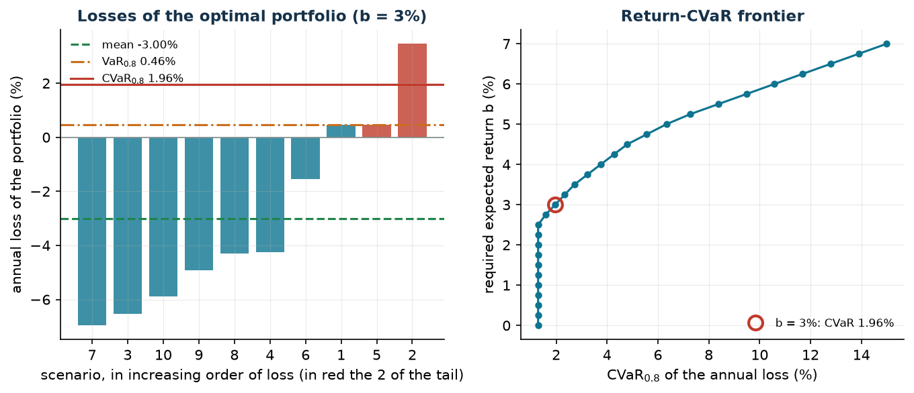

# VaR and CVaR: measuring and optimizing risk

[:material-file-pdf-box: Lecture notes (PDF)](pdf/lp-modelling-notes.pdf) · [:material-presentation: Chapter slides (PDF)](pdf/slides-09-var-cvar.pdf) · [:material-gesture-tap: App: VaR and CVaR: minimum tail-risk portfolio](lab/var-cvar.md)

**Class:** scenario-based LP · **Script:** `python/lab09_var_cvar.py`

[](https://colab.research.google.com/github/fabiofurini/lp-modelling/blob/main/notebooks/lab09_var_cvar.ipynb)

!!! nota "Prerequisites"

    - From this module, [Chapter 8 «The Newsvendor and its variants»](https://fabiofurini.github.io/lp-modelling/newsvendor/): the scenario-based LP, the positive-part trick and the mean-CVaR objective.

    - From this module, [Chapter 2 «Background: linear programming and sensitivity analysis»](https://fabiofurini.github.io/lp-modelling/theory-lp/): shadow prices and the sensitivity protocol.

!!! chiave "Objectives"

    At the end of this chapter you will be able to:

    - define and compute VaR and CVaR on a discrete distribution;

    - use the Rockafellar–Uryasev linear formulation;

    - build portfolios and logistics plans protected against the worst scenarios;

    - recognize the statistical limits of tail estimates.

Optimizing an average value can hide rare and very large losses. The **VaR**
(*Value-at-Risk*) answers "what is a high loss threshold?"; the **CVaR**
(*Conditional Value-at-Risk*) also answers "how much do we lose *on average* when
that threshold is exceeded?". The didactic surprise: the CVaR is optimized with a
simple LP.

## Definitions

For a random loss $L$ (upper case to follow the literature — an exception to the
convention that reserves capital letters for sets and matrices; realizations in lower
case $\ell_s$) and a level $\alpha \in (0.1)$:

$$
\mathrm{VaR}_\alpha(L) = \inf\{\eta : \mathbb{P}(L \le \eta) \ge \alpha\}
\qquad
\mathrm{CVaR}_\alpha(L) = \text{average loss in the worst tail of mass } 1 - \alpha .
$$

| Property | |
|---|---|
| Convexity | CVaR is convex in the decisions (if $L$ is); VaR in general is not |
| Subadditivity | CVaR rewards diversification; VaR may violate it |
| Tail | VaR does not distinguish two tails with the same quantile but different severity |
| Optimization | CVaR admits a scenario-based LP formulation; VaR does not |

!!! example "Worked example by hand (6 scenarios, α = 0.80)"
    Equally likely losses $\{2, 4, 5, 7, 12, 20\}$: VaR $= 12$ (the cumulative
    distribution reaches 0.80 there); CVaR $= 12 + \frac{1}{0{,}20}\cdot\frac{1}{6}(20 - 12) =
    \mathbf{18{,}67}$ — the formula correctly handles the mass "straddling" the
    quantile. Mean $= 8{,}33$: three numbers, three stories.

## The Rockafellar–Uryasev linear formulation

**Data (input of the model).** The number of scenarios $k \in \mathbb{Z}_{\ge 1}$,
indexed by $s \in \{1, 2, \dots, k\}$; for each scenario, the probability
$w_s \in \mathbb{Q}_{\ge 0}$ (with $\sum_{s=1}^{k} w_s = 1$) and the loss
$\ell_s(\boldsymbol x)$, a linear function of the decision vector
$\boldsymbol x$, constrained to a polyhedron $X$; the confidence level
$\alpha \in (0, 1)$.

**Decision variables.** Besides the decisions $\boldsymbol x$, we introduce one free
variable and $k$ non-negative variables:

$$
\begin{cases}
\eta = \text{candidate loss threshold (at the optimum: a VaR)}\\[1ex]
\xi_s = \text{loss in excess of } \eta \text{ in scenario } s
\end{cases}
\qquad \forall s \in \{1, 2, \dots, k\}.
$$

Using these variables, the Rockafellar–Uryasev LP model is the following:

$$
\begin{aligned}
\min ~~ \eta + \frac{1}{1-\alpha} \sum_{s=1}^{k} w_s\, \xi_s & & \\
\text{subject to} \quad \xi_s &\ge \ell_s(\boldsymbol x) - \eta, & \forall s \in \{1, 2, \dots, k\}, \\
\boldsymbol x &\in X, & \\
\eta &\gtreqless 0, & \\
\xi_s &\ge 0, & \forall s \in \{1, 2, \dots, k\}.
\end{aligned}
$$

Description of the objective function and of the constraints:

- the linear objective function is the threshold $\eta$ plus the weighted average of
  the tail excesses, amplified by $1/(1-\alpha)$; *at the optimum $\tilde\eta$ is a
  VaR and the objective value is the CVaR*: a single LP provides both measures;
- the linear **tail** constraints define the excesses: only the scenarios with a loss
  beyond the threshold contribute ($k$ linear constraints);
- the constraint $\boldsymbol x \in X$ collects the (polyhedral) constraints of the
  underlying decision problem;
- the constraints on $\eta$ and $\xi_s$ define the variables: $\eta$ is free (the
  symbol $\gtreqless$, in Gurobi `addVar(lb=-GRB.INFINITY)`), the $\xi_s$
  non-negative.

The variable $\xi_s = (\ell_s - \eta)^+$ is the loss in excess of the candidate
threshold $\eta$ (the same positive-part trick as in the Newsvendor). Minimizing over
$\eta$ balances two forces: raising $\eta$ reduces the excesses but pushes up the
threshold; the equilibrium point is exactly the $\alpha$ quantile.

## Case study 1: mean-CVaR portfolio

Three assets — TEC (technology), UTL (utilities) and GLD (gold) — and $k = 10$
equally likely annual scenarios ($w_s = 1/10$) of the return, in % (data in
`data/cvar_scenari_rendimenti.csv`). In scenario 1 the markets crash and gold rises;
in scenarios 2 and 9 gold falls. The last column is the expected return $m_i$, the
mean of the 10 scenarios.

| asset | $s = 1$ | 2 | 3 | 4 | 5 | 6 | 7 | 8 | 9 | 10 | $m_i$ |
|---|---|---|---|---|---|---|---|---|---|---|---|
| TEC ($i = 1$) | −25 | 5 | 30 | 5 | 0 | −5 | 20 | 10 | 25 | 5 | **7** |
| UTL ($i = 2$) | −8 | 2 | 6 | 4 | 5 | −6 | 8 | 3 | 7 | 9 | **3** |
| GLD ($i = 3$) | 15 | −10 | −5 | 4 | −3 | 8 | 0 | 2 | −6 | 5 | **1** |

We decide the shares $x_i$ of the capital in the three assets. The loss of the
scenario is $\ell_s(\boldsymbol x) = -\sum_{i=1}^{3} r_{is}\, x_i$, where $r_{is}$ is
the return of asset $i$ in scenario $s$; the polyhedron $X$ asks for non-negative
shares summing to 1 and an expected return $\sum_i m_i x_i$ of at least $b = 3\%$.
We minimize $\mathrm{CVaR}_{0.8}$: with 10 scenarios the tail $1 - \alpha = 0.2$ is
exactly the 2 worst scenarios.

The LP has 14 variables ($x_1, x_2, x_3$, $\eta$ and the 10 $\xi_s$) and 12
constraints. In the objective function each $\xi_s$ has coefficient $w_s/(1-\alpha) =
1/(10 \cdot 0.2) = 0.5$; the tail row $\xi_s \ge -\sum_i r_{is} x_i - \eta$ is
written with the variables on the left:

$$
\begin{array}{rrcrcrcrcrcl}
\min & & & & & & & \eta & + & 0.5 \textstyle\sum_{s=1}^{10} \xi_s & & \\[1ex]
\text{subject to} & 7\,x_1 & + & 3\,x_2 & + & x_3 & & & & & \ge & 3, \\
 & x_1 & + & x_2 & + & x_3 & & & & & = & 1, \\[1ex]
 & -25\,x_1 & - & 8\,x_2 & + & 15\,x_3 & + & \eta & + & \xi_1 & \ge & 0, \\
 & 5\,x_1 & + & 2\,x_2 & - & 10\,x_3 & + & \eta & + & \xi_2 & \ge & 0, \\
 & 30\,x_1 & + & 6\,x_2 & - & 5\,x_3 & + & \eta & + & \xi_3 & \ge & 0, \\
 & 5\,x_1 & + & 4\,x_2 & + & 4\,x_3 & + & \eta & + & \xi_4 & \ge & 0, \\
 & & & 5\,x_2 & - & 3\,x_3 & + & \eta & + & \xi_5 & \ge & 0, \\
 & -5\,x_1 & - & 6\,x_2 & + & 8\,x_3 & + & \eta & + & \xi_6 & \ge & 0, \\
 & 20\,x_1 & + & 8\,x_2 & & & + & \eta & + & \xi_7 & \ge & 0, \\
 & 10\,x_1 & + & 3\,x_2 & + & 2\,x_3 & + & \eta & + & \xi_8 & \ge & 0, \\
 & 25\,x_1 & + & 7\,x_2 & - & 6\,x_3 & + & \eta & + & \xi_9 & \ge & 0, \\
 & 5\,x_1 & + & 9\,x_2 & + & 5\,x_3 & + & \eta & + & \xi_{10} & \ge & 0, \\[1ex]
 & & & & & & & \eta & & & \gtreqless & 0, \\
 & x_1, & & x_2, & & x_3, & & & & \xi_s & \ge & 0, \quad s = 1, \dots, 10.
\end{array}
$$

```text
alpha = 0.8, b = 3%: 14 variables, 12 constraints
optimal weights: TEC 26.0%   UTL 22.0%   GLD 52.0%
  s     1     2     3     4     5     6     7     8     9    10
loss 0.46  3.46 -6.52 -4.26  0.46 -1.54 -6.96 -4.30 -4.92 -5.88
mean loss -3.00%   VaR80 0.46%   CVaR80 1.96%
shadow price of the return constraint: 1.51
```



The tail is scenario 2, where gold loses 10% (loss 3.46%), and the mass that remains
on the VaR, 0.46%, the loss shared by scenarios 1 and 5: CVaR $= (3.46 + 0.46)/2 =
1.96\%$. The optimum equalizes the losses of scenarios 1 and 5: moving capital from
one to the other would worsen the tail.

The portfolio diversifies. Gold returns only 1% on average, but weighs 52%: it gains
in the crash of scenario 1, where TEC loses 25%. The CVaR looks only where it hurts,
the losses beyond the VaR.

**The shadow price and the frontier.** The shadow price of the return constraint is
1.51: one more point of required return costs about 1.51 points of CVaR. The frontier
repeats the LP for $b$ from 0 to 7%, in steps of 0.25:

```text
    b    CVaR     TEC    UTL    GLD  shadow
 0.00    1.29   12.2%  41.1%  46.7%    0.00
 2.50    1.29   12.2%  41.1%  46.7%    0.00
 3.00    1.96   26.0%  22.0%  52.0%    1.51
 4.25    4.27   54.2%   0.0%  45.8%    2.08
 5.00    6.33   66.7%   0.0%  33.3%    3.08
 6.00   10.58   83.3%   0.0%  16.7%    4.42
 7.00   15.00  100.0%   0.0%   0.0%    4.42
b = 7.25%: infeasible (no asset returns more than 7%)
```

Up to $b = 2.56\%$ the constraint is not active: the minimum-CVaR portfolio (CVaR
1.29%) already returns 2.56%, and the shadow price is 0. Beyond, raising $b$ moves the
capital to TEC: UTL leaves just above 3.5%, and the shadow price grows on each piece
(1.51, 2.08, 3.08, 4.42), because the frontier is convex. With $b = 7\%$ only TEC is
left; above 7% the LP is infeasible.

**The level $\alpha$.** With $b = 3\%$, the level decides how many scenarios form the tail:

```text
alpha = 0.5 (tail of 5 scenarios): CVaR -0.53% | TEC 33.3%  UTL  0.0%  GLD 66.7%
alpha = 0.7 (tail of 3 scenarios): CVaR  1.29% | TEC 22.0%  UTL 34.0%  GLD 44.0%
alpha = 0.8 (tail of 2 scenarios): CVaR  1.96% | TEC 26.0%  UTL 22.0%  GLD 52.0%
alpha = 0.9 (tail of 1 scenario):  CVaR  2.20% | TEC 20.0%  UTL 40.0%  GLD 40.0%
```

With $\alpha = 0.9$ the tail is only the crash of scenario 1, and the shares move to
UTL, which loses little there. With $\alpha = 0.5$ the tail is half of the scenarios
and the CVaR is negative: in the 5 worst years the portfolio still gains, on average.

Measuring risk with the variance instead of the CVaR leads to the Markowitz
portfolio, a quadratic model: it is in the module *NLP Modelling*, page
[“The Markowitz portfolio”](https://fabiofurini.github.io/nlp-modelling/markowitz/).

## Case study 2: two-stage supply chain

Before observing the scenario we *book* capacity from the suppliers; then, having
seen the scenario, we decide the recourse. F1 is cheap but fragile: in scenarios 4
and 9 it delivers only half of the booked capacity. F2 is expensive but reliable.
Booking costs 2 € per unit from F1 and 3 € from F2; buying costs 4 € per unit from
both; each unit of unmet demand costs 10 €. There are $k = 10$ equally likely
scenarios, and the level is $\alpha = 0.8$, as in the portfolio.

| scenario $s$ | 1 | 2 | 3 | 4 | 5 | 6 | 7 | 8 | 9 | 10 |
|---|---|---|---|---|---|---|---|---|---|---|
| demand $d_s$ | 80 | 90 | 100 | 100 | 110 | 110 | 120 | 120 | 130 | 140 |
| availability of F1, $q_{1s}$ | 1 | 1 | 1 | **0.5** | 1 | 1 | 1 | 1 | **0.5** | 1 |

**Data.** Two suppliers indexed by $a \in \{1, 2\}$ with booking costs
$c^{\mathrm{pre}}_a \in \mathbb{Q}_{>0}$ and purchase costs
$c^{\mathrm{uso}}_a \in \mathbb{Q}_{>0}$; $k$ scenarios $s \in \{1, 2, \dots, k\}$
with demand $d_s \in \mathbb{Q}_{\ge 0}$ and availability $q_{as} \in (0, 1]$
(the datum that models the failure); penalty for unmet demand $g \in \mathbb{Q}_{>0}$;
risk weight $r \in [0, 1]$ and level $\alpha \in (0, 1)$.

**Decision variables.** The non-negative variables $x_a$ (capacity booked from
supplier $a$, *first-stage*: the same in all scenarios), $f_{as}$ (purchase from
supplier $a$ in scenario $s$) and $u_s$ (unmet demand in scenario $s$), the latter
two being *recourse* variables.

$$
\begin{aligned}
\min ~~ (1-r) \Bigl[ \sum_{a=1}^{2} c^{\mathrm{pre}}_a x_a + \sum_{s=1}^{k} w_s\, \phi_s \Bigr] + r\, \mathrm{CVaR}_\alpha & & \\
\text{subject to} \quad f_{as} &\le q_{as}\, x_a, & \forall a \in \{1, 2\},~\forall s \in \{1, 2, \dots, k\}, \\
f_{1s} + f_{2s} + u_s &\ge d_s, & \forall s \in \{1, 2, \dots, k\}, \\
x_a,\ f_{as},\ u_s &\ge 0, & \forall a \in \{1, 2\},~\forall s \in \{1, 2, \dots, k\},
\end{aligned}
$$

where $\phi_s = \sum_{a=1}^{2} c^{\mathrm{uso}}_a f_{as} + g\, u_s$ is the recourse
cost of scenario $s$ and $\mathrm{CVaR}_\alpha$ is the CVaR of the total cost,
linearized with the variables $\eta$ and $\xi_s$ of the Rockafellar–Uryasev model.

Description of the objective function and of the constraints:

- the objective function combines, with weight $r$, the average cost (bookings
  plus the expected value of purchases and penalties) and the CVaR of the total cost;
- the linear **capacity** constraints impose that in scenario $s$ supplier $a$ can be
  used only up to the booked capacity $x_a$, reduced by the availability
  $q_{as}$ ($2\,k$ linear constraints);
- the linear **demand** constraints impose that $d_s$ be covered by the purchases or,
  failing that, be counted as unmet demand $u_s$, which in the objective pays the
  penalty: the model is never infeasible, it "buys" infeasibility at the price of the
  penalty ($k$ linear constraints);
- the non-negativity constraints on $x_a$, $f_{as}$ and $u_s$ define the variables of
  the model.

With the 10 scenarios the model has 32 variables ($x_1$, $x_2$, 20 purchases and 10
unmet demands) and 30 constraints; the CVaR adds $\eta$, the 10 $\xi_s$ and 10 rows:
43 variables and 40 constraints. For scenario 4, for instance: $f_{14} \le 0.5\,x_1$,
$f_{24} \le x_2$ and $f_{14} + f_{24} + u_4 \ge 100$.

```text
r = 0.00: book F1 120  F2   0   mean cost 758   CVaR80 1050   service  89.2%
r = 0.50: book F1  80  F2  60   mean cost 798   CVaR80  970   service  97.7%
r = 0.75: book F1  20  F2 120   mean cost 840   CVaR80  940   service 100.0%
```

The risk-neutral decision maker ($r = 0$) books 120 units from F1 alone and accepts
the two most expensive scenarios: scenario 9, a failure with demand 130 (1180 €), and
scenario 10, demand 140 above the capacity (920 €). CVaR $= (1180 + 920)/2 = 1050$ €.
As $r$ grows, capacity migrates towards the reliable supplier: with $r = 0.5$,
**+40 € of average cost buy −80 € of CVaR** — the cost of resilience, quantified.
With $r = 0.75$ all the demand is served, for another 42 € of average cost and 30 € less
of CVaR. With $r = 1$ only the tail would count: the purchases in the other scenarios
would no longer be determined.

## Sensitivity analysis

| Parameter | Expected effect |
|---|---|
| $\alpha$ | higher ⇒ a more extreme tail estimated from fewer scenarios: more scenarios are needed for stable estimates |
| $r$ | controls the trade-off between average performance and protection |
| $w_s$ | reweighted scenarios or stress tests (adding extreme scenarios) |
| $k$ | statistical stability: repeat with different samples, as in the Newsvendor |

!!! warning "Statistical limits"
    With $\alpha = 0.9$ and $k = 10$ scenarios the tail contains a single scenario:
    the estimated CVaR is the loss of that year. With real data at least a few dozen
    scenarios are needed *beyond* the quantile. Moreover, with discrete
    distributions the VaR may not be unique ($\tilde\eta$ is *a* VaR): always compare
    $\tilde\eta$ with the empirical quantile.


## In summary

!!! chiave "In summary"

    - VaR is a high loss threshold, the $\alpha$ quantile; CVaR is the average loss in the tail beyond it.

    - CVaR is convex, subadditive and sensitive to the severity of the tail; VaR is not.

    - The Rockafellar–Uryasev LP uses a free threshold $\eta$ and excesses $\xi_s \ge 0$: at the optimum $\eta^*$ is a VaR and the value is the CVaR.

    - Extreme tails estimated from few scenarios are noisy: dozens of scenarios beyond the quantile are needed.

## Code

The complete script of the chapter — data, model, solution, sensitivity and figures —
is [`python/lab09_var_cvar.py`](https://github.com/fabiofurini/lp-modelling/blob/main/python/lab09_var_cvar.py)
(reproducible with `python3 python/lab09_var_cvar.py` from the `python/` folder).

The same code is also available as a notebook — [`notebooks/lab09_var_cvar.ipynb`](https://github.com/fabiofurini/lp-modelling/blob/main/notebooks/lab09_var_cvar.ipynb) — which opens in Colab from the badge at the top of the page and runs in the browser, with nothing to install.

??? example "Show the full script — `lab09_var_cvar.py`"

    ```python
    """Chapter 9 — VaR and CVaR: linear models and applications (scenario LP).

    Contents:
      1. Example with 6 scenarios: VaR = 12, CVaR = 18.67,
         checked with the linear formulation of Rockafellar-Uryasev
      2. Minimum-CVaR portfolio: 3 assets (TEC, UTL, GLD), 10 equally likely annual scenarios,
         alpha = 0.8 (the tail is the 2 worst scenarios), expected return at least b = 3%
      3. Return-CVaR frontier as b varies, shadow price of the return constraint
         and effect of the level alpha
      4. Two-stage supplier choice (2 suppliers, 10 scenarios): the cost of resilience
    """
    import gurobipy as gp
    import numpy as np
    import pandas as pd
    from gurobipy import GRB

    from stile import (ARANCIO, GRIGIO, ROSSO, TEAL, VERDE, intestazione, plt, salva_dat,
                       salva_dati, salva_figura)

    # ----------------------------------------------------------------------
    # 1. EXAMPLE WITH 6 SCENARIOS
    # ----------------------------------------------------------------------
    intestazione("Example with 6 scenarios: VaR and CVaR with the linear formulation")
    perdite = np.array([2.0, 4.0, 5.0, 7.0, 12.0, 20.0])
    pi6 = np.full(6, 1 / 6)
    alpha = 0.80

    # direct computation
    cum = np.cumsum(pi6)
    var_diretto = perdite[np.searchsorted(cum, alpha)]
    print(f"Losses: {perdite.tolist()}, probability 1/6 each, alpha = {alpha}")
    print(f"VaR (quantile): {var_diretto:.2f}")

    # linear formulation of Rockafellar-Uryasev: min eta + 1/(1-alpha) sum pi_s xi_s
    m = gp.Model("cvar6")
    m.Params.OutputFlag = 0
    eta = m.addVar(lb=-GRB.INFINITY, name="eta")
    xi = m.addVars(6, name="xi")
    m.addConstrs((xi[s] >= perdite[s] - eta for s in range(6)), name="tail")
    m.setObjective(eta + gp.quicksum(pi6[s] * xi[s] for s in range(6)) / (1 - alpha),
                   GRB.MINIMIZE)
    m.optimize()
    print(f"Rockafellar-Uryasev LP: eta* = {eta.X:.2f} (a VaR), CVaR = {m.ObjVal:.4f}")
    print(f"By hand: 12 + (1/0.20)·(1/6)·(20-12) = 12 + 6.67 = 18.67  OK")
    print(f"Expected value of the loss: {perdite.mean():.2f} "
          f"-> the CVaR tells the story of the tail, the mean does not.")


    def var_cvar(perd, alpha):
        """VaR_alpha and exact CVaR_alpha of k equiprobable scenarios.

        VaR = alpha-quantile (the (ceil(alpha*k))-th loss in increasing order);
        CVaR = VaR + 1/((1-alpha) k) * sum_s max(l_s - VaR, 0), the value of the
        Rockafellar-Uryasev formula: with losses tied at the VaR it counts exactly (1-alpha) k scenarios.
        """
        ordered = np.sort(perd)
        k = len(ordered)
        var_ = ordered[int(np.ceil(alpha * k - 1e-9)) - 1]
        cvar_ = var_ + np.maximum(ordered - var_, 0).sum() / ((1 - alpha) * k)
        return var_, cvar_


    # ----------------------------------------------------------------------
    # 2. MINIMUM-CVaR PORTFOLIO
    # ----------------------------------------------------------------------
    intestazione("Minimum-CVaR portfolio (LP): 3 assets, 10 scenarios")
    titoli = ["TEC", "UTL", "GLD"]
    # annual return r_is (%) of asset i in scenario s, 10 equally likely scenarios:
    # in scenario 1 the markets crash and gold rises; in scenarios 2 and 9 gold falls
    R = np.array([[-25, -8, 15],
                  [5, 2, -10],
                  [30, 6, -5],
                  [5, 4, 4],
                  [0, 5, -3],
                  [-5, -6, 8],
                  [20, 8, 0],
                  [10, 3, 2],
                  [25, 7, -6],
                  [5, 9, 5]], dtype=float)
    k, n = R.shape
    dati = pd.DataFrame(R, columns=titoli)
    dati.insert(0, "scenario", range(1, k + 1))
    salva_dati(dati, "cvar_scenari_rendimenti")
    mu = R.mean(axis=0)                       # expected return m_i (%): 7, 3, 1
    alpha_c = 0.80                            # the tail: (1 - 0.8) * 10 = 2 scenarios
    b_obb = 3.0                               # minimum required expected return (%)

    print(" s  " + "".join(f"{t:>6}" for t in titoli))
    for s in range(k):
        print(f"{s + 1:2d}  " + "".join(f"{R[s, i]:6.0f}" for i in range(n)))
    print("m_i " + "".join(f"{mu[i]:6.0f}" for i in range(n)) + "   (expected return, %)")


    def porta_cvar(b, alpha=alpha_c):
        """min CVaR_alpha of the loss -R x  subject to  expected return >= b, weights summing to 1.

        Returns the weights, the CVaR (optimal value) and the shadow price of the return constraint,
        or None if no portfolio returns at least b."""
        m = gp.Model("min_cvar")
        m.Params.OutputFlag = 0
        x = m.addVars(n, name="x")
        eta = m.addVar(lb=-GRB.INFINITY, name="eta")
        xi = m.addVars(k, name="xi")
        m.addConstr(x.sum() == 1, name="budget")
        ret = m.addConstr(gp.quicksum(mu[i] * x[i] for i in range(n)) >= b, name="return")
        m.addConstrs((xi[s] >= -gp.quicksum(R[s, i] * x[i] for i in range(n)) - eta
                      for s in range(k)), name="tail")
        m.setObjective(eta + gp.quicksum(xi[s] for s in range(k)) / (k * (1 - alpha)),
                       GRB.MINIMIZE)
        m.optimize()
        if m.Status != GRB.OPTIMAL:
            return None
        return np.array([x[i].X for i in range(n)]), m.ObjVal, ret.Pi


    x_ott, cvar_ott, ombra = porta_cvar(b_obb)
    perd = -R @ x_ott
    var_ott, _ = var_cvar(perd, alpha_c)
    print(f"\nalpha = {alpha_c}, b = {b_obb:.0f}%: {n + 1 + k} variables, {k + 2} constraints")
    print("Optimal weights: " + ", ".join(f"{titoli[i]} {x_ott[i]:.1%}" for i in range(n)))
    print(f"{'s':>3} {'loss %':>10} {'xi_s':>6}")
    for s in range(k):
        print(f"{s + 1:3d} {perd[s]:10.2f} {max(perd[s] - var_ott, 0):6.2f}")
    print(f"mean loss {perd.mean():.2f}% (expected return {-perd.mean():.2f}%), "
          f"VaR80 {var_ott:.2f}%, CVaR80 {cvar_ott:.2f}%")
    print(f"Shadow price of the return constraint: {ombra:.4f} "
          f"(one more point of return costs {ombra:.2f} points of CVaR)")
    # the losses in increasing order; tail = 1 for the 2 worst scenarios (on a tie, the last in the order)
    ordine = np.argsort(perd, kind="stable")
    salva_dat(pd.DataFrame({"rank": range(1, k + 1), "scenario": ordine + 1, "loss": perd[ordine],
                            "tail": [0] * (k - 2) + [1, 1]}), "cap09_perdite")
    salva_dat(pd.DataFrame({"stat": ["mean", "VaR", "CVaR"],
                            "value": [perd.mean(), var_ott, cvar_ott]}), "cap09_soglie")

    # ----------------------------------------------------------------------
    # 3. RETURN-CVaR FRONTIER AND EFFECT OF ALPHA
    # ----------------------------------------------------------------------
    intestazione("Return-CVaR frontier (alpha = 0.8)")
    righe = []
    for b in np.arange(0, mu.max() + 1e-9, 0.25):
        x, cv, pi = porta_cvar(b)
        righe.append((b, cv, *x, pi))
    front = pd.DataFrame(righe, columns=["ret", "cvar", *titoli, "shadow"])
    salva_dat(front, "cap09_frontiera")
    print(f"{'b':>5} {'CVaR':>7} " + "".join(f"{t:>7}" for t in titoli) + f" {'shadow':>7}")
    for r in front.itertuples(index=False):
        if r.ret in (0, 2.5, 3, 3.5, 4.25, 5, 6, 7):
            print(f"{r.ret:5.2f} {r.cvar:7.2f} " + "".join(f"{q:7.1%}" for q in r[2:2 + n]) + f" {r.shadow:7.2f}")
    x0, cv0, _ = porta_cvar(0)
    print(f"Minimum CVaR {cv0:.2f}% with expected return {mu @ x0:.2f}%: for b below this value "
          f"the return constraint is not active (shadow price 0)")
    print(f"b = {mu.max() + 0.25:.2f}%: {'infeasible' if porta_cvar(mu.max() + 0.25) is None else 'feasible'} "
          f"(no asset returns more than {mu.max():.0f}%)")

    intestazione("Effect of the level alpha (b = 3%)")
    for a in [0.5, 0.6, 0.7, 0.8, 0.9]:
        x, cv, pi = porta_cvar(b_obb, a)
        print(f"alpha = {a:.1f} (tail of {(1 - a) * k:.0f} scenarios): CVaR {cv:6.2f}% | "
              + ", ".join(f"{titoli[i]} {x[i]:.1%}" for i in range(n)))

    # ----------------------------------------------------------------------
    # 4. TWO-STAGE SUPPLIER CHOICE
    # ----------------------------------------------------------------------
    intestazione("Two-stage suppliers: reserved capacity + recourse")
    # Two suppliers (F1 cheap but fragile, F2 expensive but reliable) -> one market.
    # 1st stage: reserved capacity x_a.  2nd stage, in each scenario: purchases f_as and unmet demand u_s.
    forn = ["F1", "F2"]
    c_pren = {"F1": 2.0, "F2": 3.0}         # reservation cost €/unit
    c_uso = {"F1": 4.0, "F2": 4.0}          # purchase cost €/unit, the same for both suppliers
    pen = 10.0                              # penalty per unit of unmet demand
    dom_s = np.array([80, 90, 100, 100, 110, 110, 120, 120, 130, 140], dtype=float)
    Ss = len(dom_s)
    # availability of the fragile supplier: in scenarios 4 and 9 it delivers only half of the capacity
    disp_f1 = np.array([1, 1, 1, 0.5, 1, 1, 1, 1, 0.5, 1])
    disp = {"F1": disp_f1, "F2": np.ones(Ss)}
    alpha_f = 0.80                          # here too the tail is the 2 most expensive scenarios
    print(f"{Ss} equally likely scenarios: demand {dom_s.astype(int).tolist()}, F1 at 50% in scenarios 4 and 9")
    print(f"{2 + 3 * Ss} variables and {3 * Ss} constraints; with the CVaR {3 + 4 * Ss} and {4 * Ss}")


    def duestadi(lam, alpha_c2=alpha_f):
        m = gp.Model("twostage")
        m.Params.OutputFlag = 0
        x = m.addVars(forn, name="x")
        f = m.addVars(forn, range(Ss), name="f")
        u = m.addVars(range(Ss), name="u")
        for s in range(Ss):
            for a in forn:
                m.addConstr(f[a, s] <= disp[a][s] * x[a])
            m.addConstr(gp.quicksum(f[a, s] for a in forn) + u[s] >= dom_s[s])
        costo1 = gp.quicksum(c_pren[a] * x[a] for a in forn)
        costo2 = {s: gp.quicksum(c_uso[a] * f[a, s] for a in forn) + pen * u[s]
                  for s in range(Ss)}
        atteso = costo1 + gp.quicksum(costo2[s] for s in range(Ss)) / Ss
        if lam > 0:
            eta = m.addVar(lb=-GRB.INFINITY)
            xi = m.addVars(range(Ss))
            m.addConstrs((xi[s] >= costo1 + costo2[s] - eta for s in range(Ss)))
            cvar = eta + gp.quicksum(xi[s] for s in range(Ss)) / (Ss * (1 - alpha_c2))
            m.setObjective((1 - lam) * atteso + lam * cvar, GRB.MINIMIZE)
        else:
            m.setObjective(atteso, GRB.MINIMIZE)
        m.optimize()
        assert m.Status == GRB.OPTIMAL, m.Status
        tot = np.array([c_pren["F1"] * x["F1"].X + c_pren["F2"] * x["F2"].X
                        + sum(c_uso[a] * f[a, s].X for a in forn) + pen * u[s].X
                        for s in range(Ss)])
        serv = np.array([1 - u[s].X / dom_s[s] for s in range(Ss)])
        return {a: x[a].X for a in forn}, tot, serv


    # with r = 1 only the tail would count: the purchases in the other scenarios would not be determined
    righe = []
    for lam in [0.0, 0.5, 0.75]:
        cap, tot, serv = duestadi(lam)
        _, cvar_t = var_cvar(tot, alpha_f)
        righe.append((lam, cap["F1"], cap["F2"], tot.mean(), cvar_t, serv.mean()))
        print(f"  r = {lam:4.2f}: reserve F1 = {cap['F1']:5.1f}, F2 = {cap['F2']:5.1f} | "
              f"mean cost {tot.mean():6.1f}, CVaR80 {cvar_t:6.1f} | mean service {serv.mean():.1%}")
        print("          cost per scenario: " + " ".join(f"{c:.0f}" for c in tot))
    res2 = pd.DataFrame(righe, columns=["lam", "F1", "F2", "mean_cost", "cvar", "service"])
    salva_dat(res2, "cap09_duestadi")
    print("The risk-averse decision maker reserves more capacity from the reliable supplier:")
    print("it pays more on average, but it cuts the tail of the scenarios with unmet demand.")

    # ----------------------------------------------------------------------
    # 5. FIGURES
    # ----------------------------------------------------------------------
    fig, (ax1, ax2) = plt.subplots(1, 2, figsize=(10.8, 4.0))
    ax1.bar(range(1, k + 1), perd[ordine], color=[TEAL] * (k - 2) + [ROSSO] * 2, alpha=0.8)
    ax1.set_xticks(range(1, k + 1), [str(s + 1) for s in ordine])
    ax1.axhline(0, color=GRIGIO, lw=0.8)
    ax1.axhline(perd.mean(), color=VERDE, ls="--", label=f"mean {perd.mean():.2f}%")
    ax1.axhline(var_ott, color=ARANCIO, ls="-.", label=f"VaR$_{{0.8}}$ {var_ott:.2f}%")
    ax1.axhline(cvar_ott, color=ROSSO, ls="-", label=f"CVaR$_{{0.8}}$ {cvar_ott:.2f}%")
    ax1.set_xlabel("scenario, in increasing order of loss (in red the 2 of the tail)")
    ax1.set_ylabel("annual loss of the portfolio (%)")
    ax1.set_title(f"Losses of the optimal portfolio (b = {b_obb:.0f}%)")
    ax1.legend(fontsize=8, loc="upper left")
    ax2.plot(front["cvar"], front["ret"], "-o", color=TEAL, ms=4)
    ax2.plot([cvar_ott], [b_obb], "o", ms=10, mfc="none", mec=ROSSO, mew=2,
             label=f"b = {b_obb:.0f}%: CVaR {cvar_ott:.2f}%")
    ax2.set_xlabel("CVaR$_{0.8}$ of the annual loss (%)")
    ax2.set_ylabel("required expected return b (%)")
    ax2.set_title("Return-CVaR frontier")
    ax2.legend(fontsize=8, loc="lower right")
    salva_figura(fig, "cap09_perdite_frontiera")

    print("\nDone: chapter 9.")
    ```

## Exercises

1. Six scenarios with $\alpha = 0.90$: VaR = CVaR = 20 (the tail lies entirely on
   the last point).
2. Build an example in which the VaR violates subadditivity (two independent loans)
   and check that the CVaR does not.
3. Portfolio with $b = 3\%$: optimal CVaR and shares for
   $\alpha \in \{0.5, 0.6, 0.7, 0.8, 0.9\}$. On how many scenarios is the tail
   estimated in each case?
4. Constrained form $\max \sum_i m_i x_i$ subject to $\mathrm{CVaR}_{0.8} \le \bar c$:
   the same frontier, dual = marginal return of risk.
5. Stress test: an eleventh scenario for the suppliers (demand 150, F1 at 10%) with
   probability 1% — how does the booking change with $r = 0.5$?

<!-- laboratorio-interattivo: sezione generata da genera_laboratorio.py -->

## Interactive lab { #interactive-lab }

The app of this chapter solves the model in the browser, with the data of the case study. ▶ next to a slider makes it move by itself.
It also opens full page in the [interactive lab](lab/index.md): [VaR and CVaR: minimum tail-risk portfolio](lab/var-cvar.md).

<div class="gi gi-capitolo" data-grafico="pl-var-cvar"></div>
